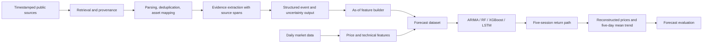

# SP73 Project Scope and Experiment Protocol V2

- Status: Working project definition based on the 7 October 2026 group meeting and the original project instructions.
- Decision date: 20 October 2026 (Asia/Shanghai).
- Scope: Forecasting research and an Agentic AI information pipeline; not an autonomous trading system.
- Precedence: This document supersedes earlier provisional model-target and schedule statements. It does not erase the original brief or completed experiment records.

## 1. Evidence and Decisions

### 1.1 Original project instructions

The brief requires a clean market dataset, two or three forecasting baselines, price/technical/text features, an Agentic AI workflow, comparison of numerical and agent-enhanced methods, forecasting/classification evaluation, and a reproducible prototype. It explicitly separates regression metrics, classification metrics, and an optional cost-aware backtest. It does not mandate one unique forecast horizon or require live buy/sell advice.

### 1.2 Supervisor meeting

The 7 October 2026 transcript establishes these requirements:

- At 10:26:07–10:27:17, the supervisor asks the team to define what the project predicts and says that this choice is the project scope and foundation.
- At 10:28:31–10:29:15, the supervisor says next-day prediction is difficult, proposes trying a 3- or 5-day horizon, presenting each of the five days, and also presenting their average/trend.
- At 10:20:05–10:20:54, the supervisor distinguishes traditional ML/deep-learning predictors from the Agentic AI workflow and asks for an architecture diagram explaining the agent's role and actions.
- At 10:23:09–10:24:20, the supervisor asks for visible implementation progress and suggests examining FNSPID as a possible comparison dataset. FNSPID is a suggestion, not a confirmed replacement for the current dataset.
- At 10:29:54–10:30:08, the supervisor recommends including oscillatory/challenging assets rather than relying only on obvious long-term upward trends.

The wording “average” is not mathematically specified in the transcript. The arithmetic mean of the next five adjusted closing prices is the team's provisional operational definition, not a verbatim mathematical requirement from the supervisor. Confirm this interpretation with the supervisor before freezing the final target contract.

## 2. Research Objective

Given all information available after the close of trading day `t`, forecast the adjusted-close price path for the next five trading sessions for each selected instrument. Compare classical/statistical and machine-learning baselines, and determine whether a structured Agentic AI news/event feature pipeline adds measurable predictive value.

The primary question is:

> Does an Agentic AI pipeline that converts timestamped public market information into auditable structured features improve five-session price-path and smoothed-trend forecasts over price/technical-only baselines?

Supporting questions:

1. How accurately do the baselines forecast each of the next five daily price changes?
2. How accurately do they forecast the average price level over the next five sessions relative to the current close?
3. Does the agent-enhanced feature set improve these metrics on the same dates, instruments, targets, and splits?
4. Which instruments and market regimes benefit or degrade, especially for the more oscillatory assets?
5. If time permits, do forecast improvements translate into a cost-aware long-only paper strategy? This is secondary and must not be presented as the primary research result.

## 3. Forecast Contract

### 3.1 Information and forecast origin

- One observation row represents one instrument on one exchange trading date.
- Forecast origin is after the close on date `t`; same-day OHLCV and technical indicators are therefore available.
- No feature may use information published or observed after that close.
- The forecast horizon is the next five instrument trading sessions, not five calendar days and not a weekly resampling period.
- The canonical price series is adjusted close (`adj_close`) for forecasting and target construction. All models use the same series.

### 3.2 Primary target: five-day path

Let `P_t` be the adjusted close at the forecast origin and `P_{t+k}` the adjusted close at the `k`th subsequent trading session. Define the observed one-session log return:

```text
r_{t+k} = log(P_{t+k} / P_{t+k-1}),  k = 1,...,5
```

The common primary path target is the vector:

```text
Y_path(t) = [r_{t+1}, r_{t+2}, r_{t+3}, r_{t+4}, r_{t+5}]
```

Every model must produce five corresponding daily return forecasts. The implied adjusted-close path is reconstructed consistently:

```text
P_hat_{t+k} = P_t * exp(sum(j=1..k, r_hat_{t+j}))
```

This is the individual five-day trajectory the supervisor asked to show. It is not a set of five unrelated cumulative-return outputs.

### 3.3 Primary smoothed-trend target

Define the arithmetic mean of the next five adjusted closing prices:

```text
P_mean_5d(t) = mean(P_{t+1}, ..., P_{t+5})
mean_price_return_5d(t) = P_mean_5d(t) / P_t - 1
```

The forecast-side mean is computed from the reconstructed path:

```text
P_hat_mean_5d(t) = mean(P_hat_{t+1}, ..., P_hat_{t+5})
mean_price_return_hat_5d(t) = P_hat_mean_5d(t) / P_t - 1
```

This level-based mean trend is the primary smoothed summary. Do not call it the average of daily returns. The arithmetic mean of five daily returns is a different statistic and may be reported only as a separately named secondary diagnostic.

### 3.4 Secondary targets

The five-session cumulative log return is retained as a conventional secondary target:

```text
cumulative_log_return_5d(t) = log(P_{t+5} / P_t)
cumulative_direction_5d(t) = 1[cumulative_log_return_5d(t) > 0]
```

This endpoint direction is not a substitute for the path or mean-price trend: the endpoint can be positive while the average future price is below the current close, or vice versa.

## 4. Model Contract and Fair Comparison

### 4.1 Common input contract

All models receive the same daily feature vector at origin `t`, built from information available through that close. The initial numerical feature set is the current returns, lags, rolling volatility, OHLC range, volume change, moving averages, EMA, RSI, MACD, and SPY-relative features. Symbol identity is handled consistently: either fit per-symbol models or provide an explicit symbol encoding to every pooled model. The experiment must state which design is being compared.

### 4.2 Model outputs

- ARIMA: forecast the next five one-session log returns as a five-step trajectory; reconstruct the five price levels and the mean-price trend.
- XGBoost: use a clearly documented multi-output implementation or five direct horizon-specific models, where output `k` is the one-session return for session `t+k`. Do not train on cumulative `t`-to-`t+k` returns and label them as daily path increments.
- Random Forest: same five daily-return targets and reconstruction contract as XGBoost.
- LSTM: same forecast origins, daily-return targets, and reconstructed outputs; sequence length is an input-window choice, not a change to the forecast target.
- Agent-enhanced variants: use exactly the same model, targets, split, and fitting protocol as the corresponding numerical-only control; only the permitted text/event features differ.

For direct multi-horizon models, each forecast origin is one sample and each output slot maps to the same future session across all models. If a model cannot support vector outputs, train one model per step while preserving the shared contract.

### 4.3 Required comparisons

The primary ablation is:

| Variant | Inputs | Purpose |
| --- | --- | --- |
| A: naive | Zero-return and last-observed-return references | Establish non-ML baselines |
| B: price/technical | Current numerical feature set | Core forecasting baseline |
| C: text-only representation added | B + timestamped news/event features from a non-agent method, if feasible | Separate text value from agent orchestration |
| D: Agentic AI enhanced | B + auditable structured agent outputs | Measure the incremental value of the Agentic AI workflow |

ARIMA is a univariate reference and cannot consume the full feature matrix. Report it as a statistical comparator, not as a feature-controlled ablation. Compare XGBoost/RF/LSTM B versus D using identical origins and protocol.

V1/V2/V3 historical labels are exploratory legacy runs, not the final fair-comparison table. Their existing 2–5-session ARIMA comparisons are invalid because ARIMA's individual step return was compared against XGBoost's cumulative origin-to-step return. Do not reuse these metrics as final results.

## 5. Data and Asset Scope

### 5.1 Current assets

The canonical processed panel currently contains AAPL, NVDA, ORCL, QCOM, and SPY, with daily records from 2019-01-02 through 2025-12-31. SPY remains the broad-market reference. The meeting's request for oscillatory assets should be handled through a documented, training-period-only volatility/oscillation analysis; do not select assets based on test-period performance. Keep the five-asset panel for the first protocol repair, then decide whether a smaller focused subset is warranted with the supervisor.

### 5.2 News and filings

The repository currently contains 30,902 Google News RSS records with titles and RSS summaries, not full article text and not the full FNSPID corpus. The meeting mentions FNSPID as a dataset worth examining; it does not instruct the team to replace current data. SEC EDGAR is named in the original project brief as a recommended source.

Before choosing the Agent source, compare current RSS, the referenced FNSPID resource, and SEC EDGAR on coverage, timestamp reliability, asset mapping, access terms, and historical completeness. Freeze one primary source for the first agent prototype and preserve other sources as optional external validation. Until this review is recorded, the source is an open decision, not an implemented feature.

## 6. Evaluation Protocol

### 6.1 Chronological splits

Keep the current calendar split provisionally:

- Train: 2019–2023;
- Validation: 2024;
- Final test: 2025.

Split by forecast origin, but require every target endpoint for a row to remain inside its intended split. Drop/purge origins whose five-session label crosses a split boundary. For a training cutoff `c`, a training origin is eligible only if its fifth target session is no later than `c`. For validation/test reporting, require the complete five-session realized path to be observable by the split end. Record counts removed by purging.

Fit scalers, imputers, feature selection, thresholds, and hyperparameters on training/validation only. Freeze all choices before evaluating the final test. In walk-forward evaluation, a model may use newly observed data only after its labels become fully observable; record each retraining cutoff and target endpoint.

### 6.2 Forecast metrics

Report metrics by model, symbol, horizon step, and split:

- Daily path: MAE and RMSE for each one-session return step `k=1..5`;
- Reconstructed price path: MAE/RMSE on adjusted price or, preferably for cross-asset scale comparability, normalized price error relative to `P_t`;
- Five-day mean trend: MAE/RMSE of `mean_price_return_5d`, plus direction accuracy against the sign of the realized mean-price return;
- Secondary endpoint: MAE/RMSE and direction accuracy for five-session cumulative log return;
- Baselines: report zero-return and last-return forecasts alongside learned models.

Direction accuracy derived from a regressor's sign is a metric, not a buy/sell instruction. Report per-symbol values before any aggregate. Aggregate with a clearly stated macro-average so large-price instruments do not dominate.

### 6.3 Trading evaluation boundary

Trading signals, position sizing, transaction costs, slippage, and portfolio backtesting are not the primary forecast task. A small long-only paper backtest is an optional downstream stage, only after forecast alignment is repaired. Its execution time must be explicit (for example, signal after close `t`, execution at the next available open), and it must use price fields consistent with adjusted-return accounting. Never present forecast accuracy alone as evidence of profitable trading.

## 7. Agentic AI System Definition

Traditional predictors and the Agentic AI pipeline are separate components. An agent is not simply an XGBoost/ARIMA model and a prompt is not a trading decision.



The first agent prototype should have bounded, testable responsibilities:

1. Retrieve or load a frozen, timestamped corpus; retain source ID, publication time, retrieval time, URL/source, and raw-text hash.
2. Deduplicate and map each item to a symbol; abstain when mapping is uncertain.
3. Extract a compact schema such as event type, sentiment/stance, impact direction, confidence, evidence quote/span, and affected symbols.
4. Validate output against a schema and retain model/prompt/version metadata. Invalid or unsupported outputs become missing/abstained features, not fabricated values.
5. Aggregate only information published by the forecast cutoff. Late-day and after-close publication handling must be explicit; after-close items are first eligible for the next trading session.
6. Compare structured agent features with a no-text baseline on exactly the same forecast origins.

The Agent must not issue buy/sell recommendations in this project phase. Human-readable summaries may explain the evidence but are not model labels.

## 8. Engineering Work Packages and Gates

### Phase 0: Freeze the specification

- Confirm the arithmetic mean of next five adjusted closes as the intended interpretation of “average”.
- Confirm post-close forecast origin and five subsequent trading sessions.
- Record the asset universe, market calendar, data-source selection, and price-adjustment convention.
- Gate: one-page target/data/split contract approved by both students and reviewed with the supervisor.

### Phase 1: Repair target and evaluation pipeline

- Add five daily future log-return labels and five adjusted-close path labels/derived outputs.
- Add five-day mean-price level and mean-price-return labels; retain cumulative five-day return as secondary.
- Add target endpoint dates and purged chronological split checks.
- Add hand-calculated unit tests for return path, reconstructed price path, mean target, endpoint direction, and split-boundary purging.
- Gate: one sample origin can be traced from input features to all five realized targets without crossing a split.

### Phase 2: Rebuild fair numerical baselines

- Correct ARIMA to emit five daily returns and derive the same path/mean outputs.
- Refactor XGBoost V1/V2/V3 target semantics or replace them with clearly named runs using the common daily-increment target.
- Add naive zero-return and last-observed-return baselines.
- Use identical forecast origins, target definitions, and scoring code; distinguish pooled versus per-symbol training as separate experiment factors.
- Gate: a prediction-contract validator confirms schema, horizon mapping, target units, and no boundary leakage for every model.

### Phase 3: Select and validate agent data source

- Audit current RSS, FNSPID availability, and SEC EDGAR against a written source matrix.
- Choose a source based on timestamp and coverage quality, not convenience alone.
- Build a frozen sample corpus and provenance manifest before calling an LLM.
- Gate: each extracted feature is traceable to an item available before its forecast origin.

### Phase 4: Build the Agent prototype

- Implement retrieval/loading, parsing and deduplication, evidence extraction, structured event generation, validation, and as-of aggregation.
- Add tests for malformed output, duplicate items, ambiguous symbol mapping, publication after cutoff, and missing evidence.
- Gate: replaying a fixed corpus yields deterministic, auditable feature rows and clear abstentions.

### Phase 5: Run controlled ablations and final evaluation

- Compare numerical-only and agent-enhanced XGBoost/RF/LSTM under the frozen protocol.
- Tune on 2024 validation only; reserve 2025 test for final evaluation.
- Produce path plots, five-day mean trend plots, per-symbol and per-horizon metric tables, error/regime analysis, and an agent evidence audit sample.
- Gate: all reported tables can be regenerated from saved predictions and run metadata.

### Phase 6: Optional decision-support backtest

- Only after model and target alignment is signed off, define a simple long-only threshold policy using validation data.
- Include transaction costs, slippage, turnover, drawdown, and a stated execution convention.
- Keep this as an optional downstream demonstration, not the claim that the forecasting model itself makes trades.

## 9. Planned Repository Structure

```text
V1/
  data/
    raw/                         # Immutable source snapshots and manifests
    processed/                   # Canonical prices, daily features, labels
    external/                    # Frozen news/filing corpus, if licensed/allowed
  src/
    data/                        # Validation, source adapters, provenance
    features/                    # Point-in-time numerical and text features
    targets/                     # Five-step labels, paths, mean/cumulative targets
    models/                      # Naive, ARIMA, RF, XGBoost, LSTM
    agents/                      # Retrieval, evidence, schema, aggregation
    evaluation/                  # Purging, metrics, walk-forward, optional backtest
  scripts/                       # Reproducible run entry points
  tests/                         # Unit, leakage, contract, and integration tests
  results/<run_id>/              # Predictions, metrics, config, logs, figures
  docs/                          # Data cards, protocol, model and agent records
```

Each run must record a unique run ID, code revision, data hashes, symbol set, feature set, target definition, model parameters, random seed, device, split boundaries, retraining cutoffs, and output file hashes.

## 10. Ownership and Deliverables

Shared responsibilities from the brief remain shared: common data contract, chronological evaluation, feature availability/leakage review, comparison, backtesting if selected, and final integration.

Proposed division, to confirm between the students:

- Student 1: ARIMA and Random Forest baselines; statistical diagnostics and path plots.
- Student 2: XGBoost and LSTM baselines; tabular/sequence model comparisons.
- Both: target/split contract, source audit, Agentic AI architecture/prototype, ablations, error analysis, and supervisor presentation.

Expected deliverables:

- Frozen target and evaluation protocol;
- Validated canonical market dataset and point-in-time feature/target pipeline;
- Reproducible numerical baselines and saved predictions;
- An auditable Agentic AI prototype and structured event features;
- Controlled numerical-only versus agent-enhanced ablation;
- Forecast report, visualizations, and reproducibility metadata;
- Optional cost-aware long-only paper backtest;
- Separate runnable student notebooks/scripts and an integrated demonstration.

## 11. Current Status and Known Corrections

Completed: five-symbol daily dataset and feature pipeline; initial ARIMA/XGBoost V1/V2/V3 experiments; GPU training runs; four-model visualization artifacts.

Not yet complete: the final five-session path/mean target contract, aligned ARIMA/XGBoost target semantics, complete purged evaluation, agent source selection, Agentic AI implementation, controlled agent ablation, and decision-support backtest.

Known legacy issues to resolve before using historical metrics as final evidence:

1. ARIMA currently stores the `h`th one-session return as its `h`-day prediction, while XGBoost's `target_return_h` is cumulative from origin to day `h`.
2. Existing XGBoost V1 training does not purge rows whose forward target endpoint crosses the training cutoff.
3. Existing evaluation splits are assigned by origin date only; five-session targets can cross validation/test boundaries.
4. Existing V1/V2/V3 vary more than one factor (training cadence, symbol encoding, and pooling), so their performance gap cannot be attributed to pooling alone.
5. Existing V1 technical documentation still describes one-day labels as if they were the final model target; this is only the original data-pipeline label, not the new project-level forecast contract.

Until these are corrected and rerun, previously reported multi-day cross-model metrics are exploratory and must be labeled as such.
